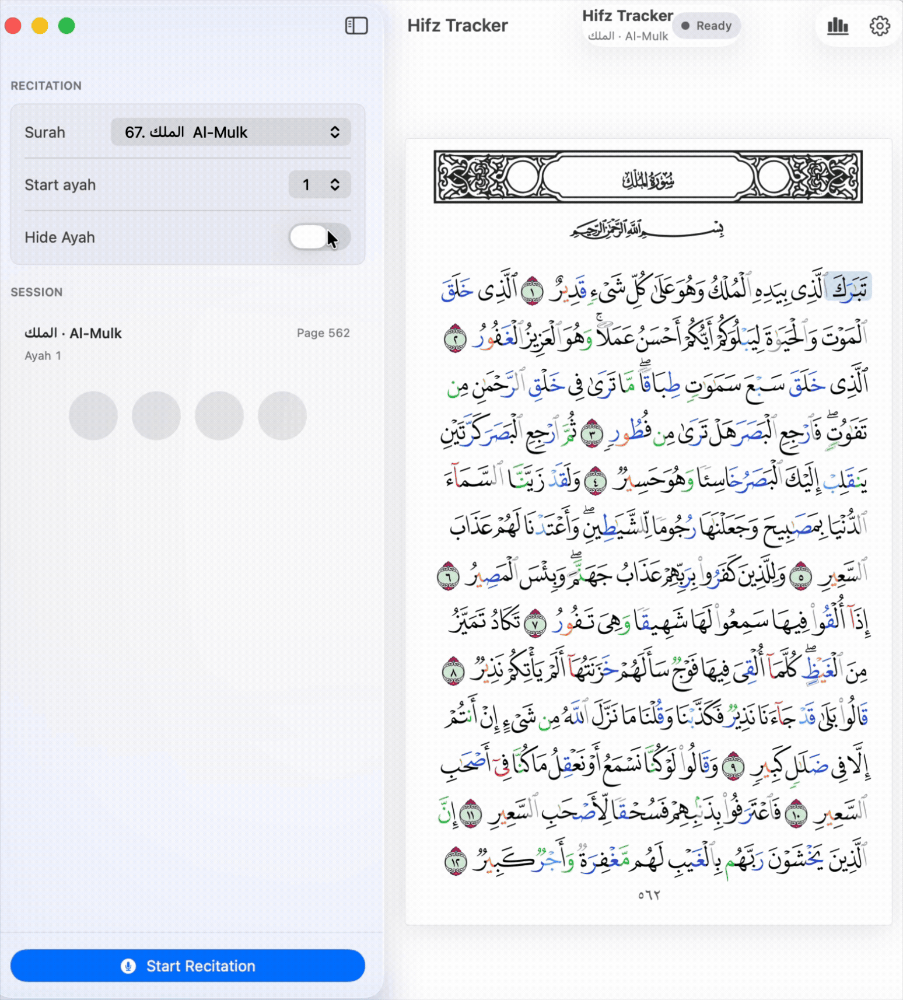

<p align="center">
  
</p>

# Hifz Tracker

Hifz Tracker is a private, offline-first macOS app for Quran memorization practice. Choose a surah and start ayah, recite into your Mac, and follow live Mushaf highlights while session progress is saved locally.

**Page URL:** [https://moabdelmoez.github.io/hifz-tracker/](https://moabdelmoez.github.io/hifz-tracker/)

**Download:** [Hifz Tracker v0.1.0 alpha](https://github.com/moabdelmoez/hifz-tracker/releases/download/v0.1.0-alpha/HifzTracker-0.1.0-arm64.dmg)

## Install the free tester build

The current alpha is ad-hoc signed and is **not notarized by Apple**. On first launch,
macOS will explain that Apple cannot verify the app is free of malware. This means Apple
has not verified the developer or scanned this build through notarization; it is not a
malware detection.

1. Download and open the DMG, then copy HifzTracker into Applications.
2. Open HifzTracker once. When macOS blocks it, click **Done**.
3. Within about one hour, open **System Settings → Privacy & Security** and scroll to Security.
4. Click **Open Anyway**, authenticate, then click **Open**.

The approved copy should open normally afterward. A newly downloaded update may require
approval again, and managed work or school Macs may not allow the override. Only continue
if you trust the download source. See [Apple's Open Anyway guidance](https://support.apple.com/en-us/102445).

Optional checksum verification:

```bash
shasum -a 256 ~/Downloads/HifzTracker-0.1.0-arm64.dmg
```

The result must match `1c6a12a9bfe02478c795a46862b913b5eeb23199b5b4a832ad1e5b7059618642`.
The release also includes a [checksum file](https://github.com/moabdelmoez/hifz-tracker/releases/download/v0.1.0-alpha/HifzTracker-0.1.0-arm64.dmg.sha256).

## Features

<p align="center">
  
</p>

- Live recitation sessions with surah selection, start-ayah control, recording controls, and session status.
- QPC V4 Tajweed Mushaf page rendering with automatic page movement as recitation advances.
- Local ASR-backed progress highlighting through `HifzCore`, Quran reference words, and ONNX Runtime.
- Cross-surah live highlighting so progress can continue into the immediate next surah.
- Hide Ayah mode that hides unrecited text from the selected start ayah while revealing completed or flagged words.
- Dashboard window with word-based progress summaries across all 114 surahs.
- Voice activity indicator for active recording sessions.
- Local session persistence with SwiftData.
- Privacy-oriented runtime: no user audio persistence and no runtime network requirement after installation.

## Tech Stack

- Swift 6 and Swift Package Manager.
- macOS 14+ SwiftUI app target.
- SwiftData for local session records.
- `HifzCore` library for Quran references, Mushaf rendering, transcript locating, recitation state, and ASR helpers.
- ONNX Runtime 1.26.0 for local Quran STT inference through `COnnxRuntimeShim`.
- SQLite-backed Quran resources, QPC V4 word glyphs, Tanzil reference text, and QUL/QPC font assets.
- XCTest coverage for core recitation logic, renderer behavior, live ASR scheduling, dashboard progress, and app view-model flows.
- Static GitHub Pages site under `docs/`.

## Repository Layout

```text
HifzTracker/              macOS SwiftUI app, views, services, models, resources
Sources/HifzCore/         Core recitation, Quran, ASR, renderer, and storage logic
Sources/COnnxRuntimeShim/ C bridge target for ONNX Runtime headers
Tests/                    HifzCore and HifzTracker test suites
docs/                     Static GitHub Pages site
script/                   Build, asset setup, release check, and packaging scripts
```

## Local Development

Requirements:

- macOS 14 or later.
- Apple Silicon Mac for the packaged runtime path.
- Swift 6 toolchain or a recent Xcode toolchain that supports the package.

Run the standard verification checks:

```bash
swift test
swift build
```

Build and launch the local app bundle:

```bash
./script/build_and_run.sh
```

For release-sensitive checks, use:

```bash
./script/release_checks.sh local
```

Run `./script/setup_assets.sh` only when preparing model, font, layout, or release assets.

## Citations

- [Mushaf Layout](https://qul.tarteel.ai/resources/mushaf-layout/19)
- [Quran Speech-to-text](https://huggingface.co/Saboorhsn/quran-stt-onnx)
